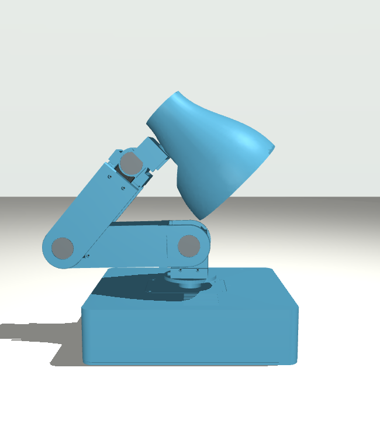
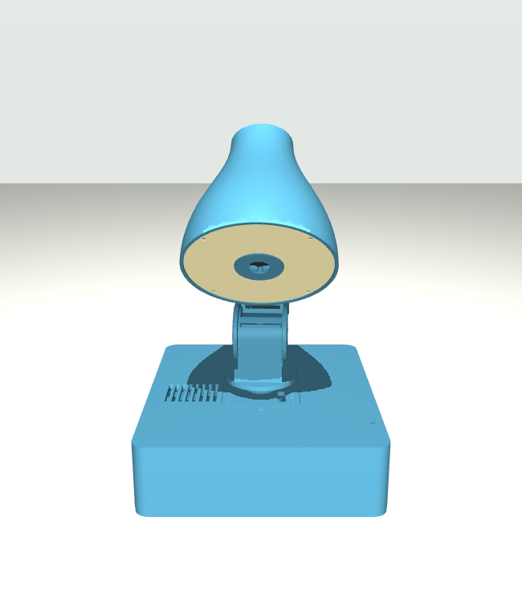

# Orion hardware versions

`oriond` defaults to V2. Pass `--hardware v1` when starting a V1 lamp.

## Hardware differences

| Item | V1 | V2 |
| --- | --- | --- |
| Lights | 40-pixel RGBW matrix | 24-pixel RGBW ring |
| Light output | GPIO12 | GPIO12 |
| Audio | ReSpeaker 2-Mics V2 HAT | XVF3800 USB array |
| Camera | None | IMX708 Wide |
| Hardware profile | `hardware/profiles/v1.json` | `hardware/profiles/v2.json` |
| Joint configuration | `simulation/mujoco/config/servo_calibration.json` | `hardware/profiles/v2-joints.json` |
| Pose file | `motion/config/v1/poses.yaml` | `motion/config/v2/poses.yaml` |
| Motion directory | `motion/motions/v1/` | `motion/motions/v2/` |
| Scene directory | `scenes/v1/` | `scenes/v2/` |
| Simulation scene | `simulation/mujoco/scene.xml` | `simulation/mujoco/v2/scene.xml` |

V2 stores each servo's zero position in its onboard EEPROM (non-volatile memory that persists when power is off), and takes joint IDs, directions and limits from `hardware/profiles/v2-joints.json` instead of a per-lamp calibration file.

## Calibrate V2 first

Every new servo ships with the same default ID, so you must assign each servo's joint ID individually before assembling the chain. Once the lamp is assembled—or after replacing a servo or removing a horn—fold it into the rest pose and write its zero offsets.

WARNING: Powered joints can pinch fingers. Disconnect servo power before changing any wiring.

1. Stop the Orion services so nothing else holds the serial port.

   ```bash
   sudo systemctl stop orion-voice-stack orion-vision orion-studio-gateway orion-listener oriond
   ```

2. Plug one new servo into the servo bus on its own, then assign its joint ID (for example, `shoulder_pitch_joint`).

   ```bash
   oriond servo set-id --joint shoulder_pitch_joint
   ```

3. Repeat that step for each of the remaining four joints (`base_yaw_joint`, `elbow_pitch_joint`, `head_pitch_joint` and `head_roll_joint`).
4. Connect all five servos in the daisy chain.
5. Fold the lamp into the mechanical rest pose shown below: the **lower arm** (attached to the shoulder) lies back along the base, the **upper arm** (attached to the elbow) folds forward over it, the shoulder housing supports the head, and both the head and base face straight forward.




CAUTION: An incorrect fold writes the wrong zero offsets and can cause joint damage once the lamp moves. Let go of the lamp and keep it completely still while zeroing.

6. Write the mechanical-rest offsets to the servos.

   ```bash
   oriond servo zero
   ```

7. Read back the joint positions without enabling torque to confirm every joint sits near `0` radians.

   ```bash
   oriond --check
   ```

   Zeroing waits for two seconds with no movement greater than 10 encoder counts, then verifies that every servo reads `2047 ±8` counts. If any step fails, `oriond` restores the previous offsets and keeps torque off.

WARNING: Orion moves slowly toward `home` as soon as its services start. Keep people and objects clear of its movement area.

8. Start the Orion services.

   ```bash
   sudo systemctl start oriond orion-listener orion-studio-gateway orion-voice-stack orion-vision
   ```

These commands automatically pick the single connected USB servo adapter; pass `--port` if more than one adapter is attached.

## Joint names and limits

In Orion's V2 CAD and assembly guide, the **lower arm** is the link driven by the shoulder, and the **upper arm** is the link driven by the elbow.

| V2 ID | Joint name | Movement |
| --- | --- | --- |
| 1 | `base_yaw_joint` | Base turn |
| 2 | `shoulder_pitch_joint` | Lower-arm tilt |
| 3 | `elbow_pitch_joint` | Upper-arm tilt |
| 4 | `head_pitch_joint` | Head tilt at the wrist |
| 5 | `head_roll_joint` | Head swivel at the neck |

V1 reverses the last two IDs, assigning ID 4 to `head_roll_joint` and ID 5 to `head_pitch_joint`.

V2 converts raw encoder counts (`0–4095`) to radians using:

```text
angle = (raw - 2047) × direction × 2π / 4096
```

`hardware/profiles/v2-joints.json` defines the permitted command range for each joint. On startup, `oriond` accepts readings up to 20 counts outside that range and clamps initial goals back inside, after which strict profile limits apply. The runtime rejects any configured range that crosses the `0/4095` wrap-around boundary. Because range checks cannot detect a misfolded lamp, mechanical-rest zeroing remains essential.

## USB capture and playback

V2 uses the XVF3800 USB microphone array (ALSA card `Array`). `orion-listener` owns microphone capture and `oriond` owns speaker playback, using defaults from the hardware profile.

The installer adds the login user to the required device groups and installs `voice/99-respeaker-xvf3800.rules` (reboot required). V1 audio setup is covered in the [V1 audio HAT guide](../hardware/audio/README.md).

## Lights and camera

Both hardware versions drive the LEDs through the [GPIO12 lighting driver](../hardware/lighting/README.md). V2 uses the [vision service](../vision/README.md) for camera capture and local detection.
