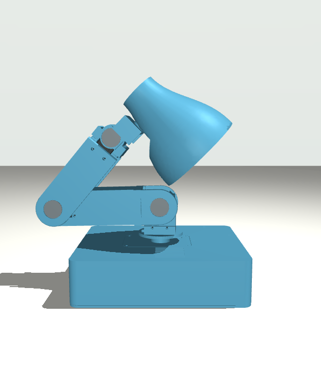
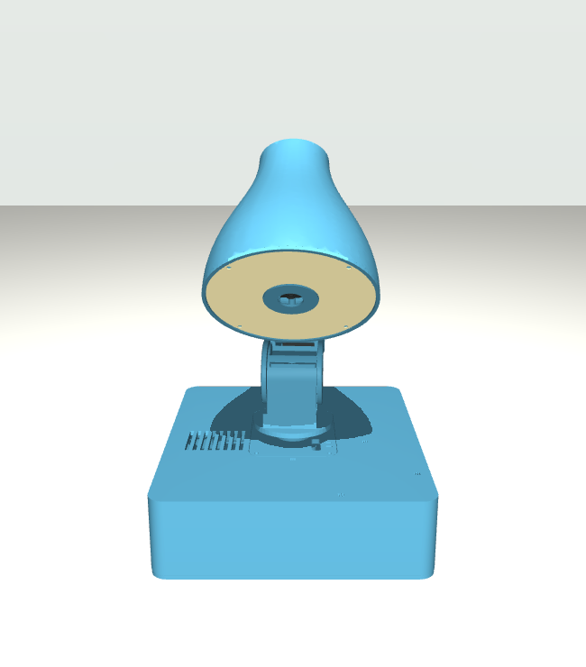

# Orion hardware versions

Use `--hardware v1` or `--hardware v2` to match your robot. This selects its
lights, audio devices, joint mapping, poses, movements and scenes. V2 is the
`oriond` default; pass `--hardware v1` for an existing V1 lamp.

<a id="select-the-hardware-profile"></a>

## Hardware differences

The profiles are saved in `hardware/profiles/v1.json` and
`hardware/profiles/v2.json`.

| Hardware or file | V1 | V2 |
| --- | --- | --- |
| Lights | 40-pixel RGBW matrix | 24-pixel RGBW ring |
| Light connection | GPIO12 on the Pi 5 | Same GPIO12 driver |
| Audio | ReSpeaker 2-Mics V2 HAT, `seeed2micvoicec` | XVF3800 USB, `Array` |
| Camera | No camera service | IMX708 Wide camera, managed by `orion-vision` |
| Joint mapping and limits | V1 `servo_calibration.json` | Tracked `hardware/profiles/v2-joints.json` |
| Poses | `motion/config/v1/poses.yaml` | `motion/config/v2/poses.yaml` |
| Movements | `motion/motions/v1/` | `motion/motions/v2/` |
| User poses | `motion/user/poses/v1/` | `motion/user/poses/v2/` |
| Scenes | `scenes/v1/` | `scenes/v2/` |
| Simulation | `simulation/mujoco/scene.xml` | `simulation/mujoco/v2/scene.xml` |

V2 shares one rest-relative joint profile across the hardware runtime,
trajectory compiler and Studio. Servo EEPROM stores each motor’s homing offset;
no V2 calibration file belongs in `~/.config/orion/`.

## Calibrate V2 first

Stop the services before assigning IDs or zeroing:

```bash
sudo systemctl stop orion-voice-stack orion-vision orion-studio-gateway orion-listener oriond
```

1. **New servos only:** connect one servo at a time and assign its joint ID.
   For example, `oriond servo set-id --joint shoulder_pitch_joint` sets ID 2.
   The tool scans IDs 1–253 at 1 Mbps and refuses unless exactly one answers.
2. Connect all five servos. Fold the lamp into the mechanical rest shown below:
   upper arm back on the base, forearm folded over it, head supported by the
   shoulder housing and facing ahead, base facing ahead, motors off.
3. Run `oriond servo zero`. It keeps torque off, requires two seconds without
   movement greater than 10 counts, then writes, reads back and locks each
   homing offset. Every joint must read 2047 ±8. On failure it restores the old
   offsets and reports any incomplete recovery.
4. Run `oriond --check`. All joints should read near **0 radians**.
5. Start Orion; it rises slowly to `home`:

   ```bash
   sudo systemctl start oriond orion-listener orion-studio-gateway orion-voice-stack orion-vision
   ```




Both commands select the single detected USB servo adapter automatically.
Use `--port /dev/ttyACM0` when more than one adapter is connected. Repeat zeroing
only after replacing a servo or removing a horn. Zeroing assumes the lamp is
folded correctly; software cannot identify a mechanically supported pose from
encoder readings alone.

V2 angles use `(raw - 2047) * direction * 2*pi/4096`. The profile contains IDs,
directions and limits in radians from rest. The runtime rejects ranges crossing
0/4095 and refuses torque outside the profile with a `run oriond servo zero`
message. An un-zeroed lamp can happen to read inside those limits, so the range
check does not replace the folding and zeroing procedure.

The renders are kinematic builder references. The [model reference](../simulation/mujoco/config/model_reference-v2.json)
records the FK migration proof, photo landmarks, pitch corrections and ±2°
projection uncertainty. They do not establish collision clearance or balance.

## Joint names and directions

V2's joints run from the base through the shoulder, elbow, wrist and neck.
Commands and pose files keep the existing software joint names:

| V2 servo ID | Software joint name | What it moves |
| --- | --- | --- |
| 1 | `base_yaw_joint` | Turns the base |
| 2 | `shoulder_pitch_joint` | Tilts the upper arm |
| 3 | `elbow_pitch_joint` | Tilts the forearm |
| 4 | `head_pitch_joint` | Tilts the head at the wrist |
| 5 | `head_roll_joint` | Turns the head at the neck |

On V1, servo 4 controls `head_roll_joint` and servo 5 controls
`head_pitch_joint`. V2 uses the assignments above. The runtime rejects servo IDs that disagree with the selected hardware profile.

With `encoder_direction: 1`, V2 moves in these directions:

| Software joint name | Negative angle | Positive angle |
| --- | --- | --- |
| `base_yaw_joint` | Turns to the lamp's left | Turns to the lamp's right |
| `shoulder_pitch_joint` | Leans back | Leans forward |
| `elbow_pitch_joint` | Raises the forearm | Lowers the forearm |
| `head_pitch_joint` | Tilts the head up | Tilts the head down |
| `head_roll_joint` | Turns the head to its left | Turns the head to its right |

The tracked V2 profile fixes `direction: 1` for these mechanisms. Changing a
mechanical joint direction requires reviewing the profile and model together.
Joint angles use radians; model distances use metres.

Read calibrated hardware state without enabling the motors:

```bash
runtime/target/release/oriond --hardware v2 --check --port /dev/ttyACM0
```

For supervised movement tests, follow the [hardware lifecycle](../runtime/README.md#physical-hardware)
and start with `--serve --hardware v2 --character-on-start off`.
V2's elbow setting still needs physical validation: check that each
`lean_reach_*` pose finishes and that the elbow does not hum or oscillate.
Motor settings are in [runtime/src/devices/sts3215/driver.rs](../runtime/src/devices/sts3215/driver.rs).

<a id="led-and-usb-audio-setup"></a>

## Lights, audio and camera

The V2 ring uses the same [GPIO12 light driver](../hardware/lighting/README.md#persistent-raspberry-pi-5-setup)
as V1. After installing it, reboot and run
`hardware/lighting/verify-persistent.sh`.
Use `--hardware v2` with `oriond` when checking the ring or USB audio.

### USB capture and playback

V2 records two audio channels from the XVF3800 and uses processed channel 0,
which contains the board's cleaned microphone audio. For different firmware
layouts, the listener accepts `--capture-channels 2|6 --processed-channel N`.
See the [Seeed USB guide](https://wiki.seeedstudio.com/respeaker_xvf3800_introduction/).

Microphone direction readings are optional; see [listener settings](configuration.md#microphone-listener).
To read them, install the [XVF3800 USB access rule](../voice/README.md#measure-the-xvf3800-on-v2),
add the account running Orion to `plugdev` with `sudo usermod -aG plugdev USER`,
and restart the listener. Replace `USER` with that account's name. Recording
can work without this permission even when direction readings fail. Release installation installs the USB access rule and adds the user to `plugdev`.

`oriond` sets both USB playback volume controls to 0 dB at startup. To set them
by hand:

```bash
amixer -c Array sset PCM,0 0dB unmute
amixer -c Array sset PCM,1 0dB unmute
```

### Camera

V2 runs `orion-vision` to capture camera images and detect faces and objects.
The release installer selects camera libraries and Python bindings for the OS;
see [vision setup](../vision/README.md#setup-on-raspberry-pi-os).
The V2 release includes the service. Studio's camera setting controls whether
it captures images. V1 has no camera service.

<a id="cad-urdf-and-mujoco"></a>

## Simulation

V2 uses `description/urdf/orion-v2.urdf` as its robot model and
`simulation/mujoco/v2/scene.xml` for MuJoCo simulation. Studio and simulation
use the same joint angles as the calibrated robot. Prepare the
[simulator environment](../simulation/mujoco/README.md#python-environment)
and build the runtime before starting a V2 preview:

```bash
runtime/target/release/oriond --serve --backend mujoco --hardware v2 \
  --character-on-start on
```

The preview shows movement with a fixed base. It does not prove balance,
collision clearance or how well the real motors follow a movement. The older
standalone pose editors assume V1 geometry.

For model work:

| File | What it contains |
| --- | --- |
| [simulation/mujoco/config/model_reference-v2.json](../simulation/mujoco/config/model_reference-v2.json) | Mechanical-rest alignment, migration evidence and photo measurements. |
| `simulation/mujoco/v2/mass-properties.json` | Estimated part masses and weight distribution. |
| `simulation/mujoco/v2/mass-inputs.example.json` | An example file for supplying measured part weights and additional components. |

To rebuild the model or update its mass estimates:

```bash
.venv/bin/python scripts/import_v2_model.py
.venv/bin/python scripts/estimate_v2_inertias.py --inputs /path/to/mass-inputs.json
```

See the [robot description](../description/README.md#v2-camera-and-light-frames)
for model alignment and camera coordinates.

## Deploy the selected version

Use the [release installer](quickstart.md#install-or-update) for installation,
updates and rollback. It preserves user assets and settings. Motion stays off
when its direct hardware check fails.

Installed V1 and V2 services start Orion's automatic movement and light
behaviours. When starting `oriond` by hand, V1 defaults to `on` and V2 defaults
to `off`. Use `--character-on-start on|off` to choose explicitly. See
[runtime startup settings](configuration.md#customising-the-oriond-runtime).
