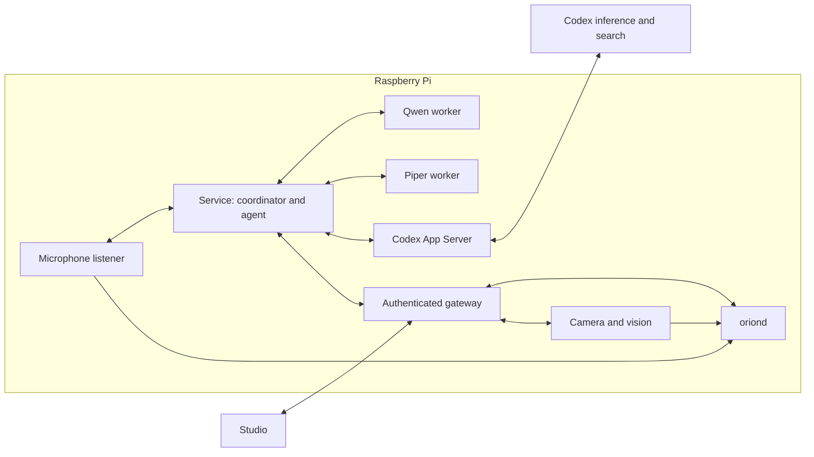

# Orion system architecture

Orion splits its work across small, focused programs on the Raspberry Pi so slow AI models and network requests never block real-time motor control or audio capture. Most work—hearing, speech recognition, speech synthesis, camera detection, lighting, alarms and movement—runs locally on the lamp; only Codex replies and web search require internet access. Studio runs remotely on your computer as an optional control and editing app.

## System boundary



Every program runs in its own process with a clear resource boundary, keeping model inference and network waits completely outside the 50 Hz movement loop.

## Authority boundaries

| Service | Ownership |
| --- | --- |
| `oriond` | Servo bus, LED ring, speaker playback and movement lifecycle |
| `orion-listener` | Microphone capture, wake detection and voice-session boundaries |
| `orion-voice-stack` | Coordinator, Codex agent and local speech workers |
| `orion-studio-gateway` | External authentication, asset publication and local forwarding |
| `orion-vision` | Camera capture, in-memory frames and local detections |

### Hardware runtime

`oriond` is the single gatekeeper for the motors. It checks every goal against joint limits, compiles trajectories and verifies measured completion—scenes, speech, gaze and idles all go through the same ownership rules. Hardware and MuJoCo implement the exact same driver interface and receive identical 50 Hz samples, differing only in where feedback comes from.

### Camera and vision

Vision keeps only the latest camera frame in memory (never written to disk) and schedules face, palm and object detection on one bounded worker outside the camera callback. Capture-time joint geometry turns pixel detections into stable base-frame bearings, so a picture taken mid-turn still points accurately. Gaze requests pass through runtime compilation and can never bypass Stop, rest, foreground ownership or joint limits.

Turning camera privacy off closes capture and clears image buffers. Setting tracking to `Off` stops background inference while still permitting live viewing in Studio. Live viewing requires runtime permission (blocked while resting), lights one cyan pixel on the LED ring while active, and cannot be triggered by background detection polling.

Explicit object aims (`"look at the mug"`) return `aimed`, `clamped`, `not_found` or `ambiguous` (asking you to pick when several match), intersecting camera rays with the desk plane rather than measuring true 3D depth. Explicit visual questions follow the [look contract](voice-architecture.md#look-tool-contract) and are separate from autonomous background observations.

### Listener and voice host

`orion-listener` owns microphone capture and speech endpoints, keeping 3 seconds of rolling pre-roll in memory so nothing before `"Hey Orion"` is cut off. Qwen confirms the wake phrase on a short prefix before visual/audio wake feedback runs, and rejected false alarms never reach the agent.

`orion-voice-stack` keeps the Codex agent alive across speech-worker restarts, talks to Qwen and Piper over private pipes, and streams validated reply audio to `oriond` through the local gateway.

### Gateway and Studio

`orion-studio-gateway` authenticates Studio over HTTP with a bearer token and exposes a fixed set of robot operations rather than arbitrary shell or servo commands. Studio keeps local drafts and pairing credentials on your computer, while the Pi stores published assets and runtime settings—closing Studio leaves Orion running uninterrupted.

## Assets and installed releases

Release installations keep immutable program versions separate from editable user assets and shared AI models, verifying archive and payload checksums before switching. Native package holds preserve compatible camera, KMS and Hailo libraries across OS updates, and `--rollback` restores the previous release's packages and configuration (though it cannot undo servo EEPROM zeroing). See [release packaging](release-packaging.md).

## Automatic rest and waking

In **Idle mode**, Orion starts an inactivity timer after reaching `home` (Lamp mode disables automatic rest). Confirmed voice sessions reset the timer once, and active conversations, speech, scenes or optional presence sightings can defer descent without resetting the underlying deadline.

```text
awake → going_to_rest → resting
  ↑                        │ confirmed wake
  └──────── waking ─────────┘

failed sleep step → direct rest → resting
                         │ failed
                         └──────→ awake, light on

failed wake → fault, light on
```

`oriond` tracks descent by run ID and releases servo torque only after measured arrival at `rest`. If a decorative sleep step fails, Orion tries a direct rest once; if that fails too, it returns `home` and keeps its light on with the failure reason in status (entering `fault` if homing also fails). Normal desk movements stay inside a comfort envelope, while `home` and `rest` returns plan from the measured pose using full calibrated limits.

A confirmed `"Hey Orion"` at rest raises the lamp back to `home` (or waits if it is mid-descent), keeping the microphone open while moving and holding queued reply audio until homing and attention complete. Stop, disable, presence sightings and Studio camera viewing never enable torque or wake a resting lamp. Studio's **Go to rest** and the voice sleep tool trigger descent immediately, while direct CLI `rest` moves require a separate `--disable` call.

## Timers and alarms

`oriond` owns timers, reminders and one-time or recurring alarms locally so they work even when Studio or the internet is offline (relying on an accurate Pi clock and time zone; spring DST gaps skip and autumn repeats fire once on the earlier pass). Up to 32 active alerts and 64 total entries are stored.

When an alert rings, it interrupts speech and scene audio without enabling torque and stops after 5 minutes if left alone; saying `"Hey Orion"` dismisses it locally, or you can stop it in Studio. Reminders announce only while idle and mark delivery before sending acknowledgements so retries never double-speak; next-conversation reminders stay in the agent store until reply playback finishes. Sunrise, wind-down and focus light routines use the same scheduler, and sunrise can illuminate from mechanical rest without moving the arm.

## Light and rest status

Going to rest fades Orion's light out and suppresses ordinary light output while preserving your saved lamp preferences until the next wake. Status reports `disabled`, `awake`, `going_to_rest`, `resting`, `waking` or `fault`, along with the active run ID, remaining deadline and any failure reason.

## System metrics

The gateway samples Pi CPU, memory, disk, temperature and throttling counters in memory for Studio's **System** page; no metrics are written to disk. See [system metrics configuration](configuration.md#system-metrics) for counter details.

## Household devices

Orion integrates with household devices through an independent `orion-home-assistant` Docker container installed on demand via a scoped `polkit` rule (`orion-home-assistant-install.service`), keeping Docker socket access away from the gateway.

The gateway holds the private Home Assistant token on the Pi and reads Home Assistant's native assistant exposure setting on every voice request rather than keeping a separate allowlist. Orion can control lights, switches, fans, climate devices, covers and media players (one entity per call, asking for a room if names conflict), and explicitly refuses locks, alarm panels, garage doors, gates, scenes and scripts. See [Home Assistant configuration](configuration.md#home-assistant) and [Studio Home](../orion_studio/README.md#home).
