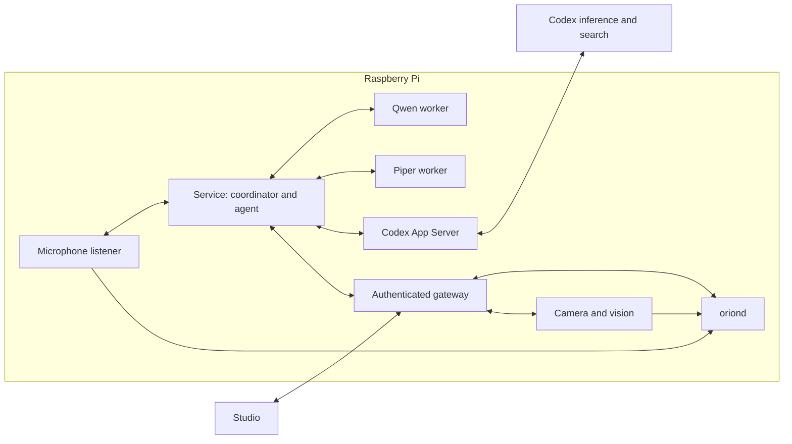

# Orion system architecture

The Pi runs hardware control, camera processing, speech recognition, speech synthesis and the voice host. Studio provides remote controls and editing. Codex inference and web search use online services.

## System boundary



Model execution and network waits stay outside the 50 Hz movement loop. Each process owns a specific resource or request boundary.

## Authority boundaries

| Service | Ownership |
| --- | --- |
| `oriond` | Servo bus, light output, speaker playback and movement lifecycle |
| `orion-listener` | Microphone capture, wake candidates and voice sessions |
| `orion-voice-stack` | Coordinator, agent and speech workers |
| `orion-studio-gateway` | External authentication, asset publication and local request forwarding |
| `orion-vision` | Camera capture, in-memory images and local detections |

### Hardware runtime

Only the runtime writes servo goals. It checks joint limits, compiles trajectories and measures completion. Scenes, speech, gaze and idle planners share its ownership rules.

Hardware and MuJoCo implement the same driver interface. They receive the same compiled samples. Their feedback sources differ.

### Camera and vision

Vision retains the latest frame in memory. Camera callbacks do not encode JPEGs or run models. One bounded worker schedules face, palm and object work.

Capture-time geometry converts camera rays into base-frame bearings. Gaze requests pass through runtime compilation. Vision cannot bypass Stop, rest, foreground ownership or joint limits.

Camera privacy closes capture and clears image buffers. Tracking Off stops background inference but permits plain viewing. Other tracking modes select observations or following behavior.

Gateway viewing requires runtime permission. A cyan ring band indicates active viewing. Rest blocks streams and snapshots. Detection polling cannot create viewing permission.

Explicit object aiming follows agent, coordinator, gateway, vision and runtime planning. A voice resource lock separates object lookup from speech inference and playback. Search movement uses runtime-owned poses and completion checks.

An aim can return `aimed`, `clamped`, `not_found` or `ambiguous`. Ambiguous results require a target choice. Desk rays assume a base-frame plane; they cannot establish an object's actual support surface.

Explicit visual questions follow the [look contract](voice-architecture.md#look-tool-contract). Image access is separate from autonomous observations.

### Listener and voice host

The listener owns audio capture and speech boundaries. Acoustic verification gates wake feedback. The coordinator confirms complete command text before an agent request.

The service host preserves the agent across speech-worker reloads. Workers use private pipes. The coordinator uploads reply audio through the local gateway and waits for runtime playback completion.

### Gateway and Studio

The gateway uses bearer-token authentication. It accepts a fixed set of operations rather than arbitrary shell or servo commands. It forwards requests over local sockets or the service interface.

Studio stores local drafts and desktop pairing. The Pi stores published user assets and operating settings. Closing Studio leaves Pi services running.

## Assets and installed releases

The installer separates immutable release programs, editable user assets and shared models. A release switch updates programs, built-in assets and service configuration together.

The installer verifies archive and payload checksums. Virtual environments use the bundled Python and offline wheels. Native package holds preserve camera and Hailo compatibility.

Rollback restores the previous release's package versions before restarting its services. It does not reverse servo EEPROM changes. See [release packaging](release-packaging.md).

## Automatic rest and waking

Idle mode starts an inactivity deadline after successful homing. Lamp mode keeps Orion awake. Confirmed voice sessions refresh the deadline once. Unconfirmed candidates do not refresh it.

Conversations, foreground motion, scenes and speech can delay descent. Optional fresh presence can also defer automatic rest. An expired deadline remains expired while work delays it.

```text
awake → going_to_rest → resting
  ↑                        │ confirmed wake
  └──────── waking ─────────┘

failed sleep step → direct rest → resting
                         │ failed
                         └──────→ awake, light on

failed wake → fault, light on
```

The rest coordinator tracks descent by movement run ID. It releases torque only after measured completion.

A failed sleep step starts direct rest once. If direct rest fails, Orion returns home and keeps the light on. Status retains the failure reason.
If the home return also fails, Orion reports `fault` and keeps the light on.
The desk comfort envelope limits normal desk movements. Home and rest returns start from the measured pose. They use calibrated joint limits without requiring a start inside this envelope.
New home and foreground anchors replace the previous desk and posture-drift settings.

A confirmed wake at rest starts home. Confirmation during descent waits for descent to finish. Capture continues while the body moves. Queued reply playback waits for home and accepted attention movement.

Stop, disable and maintenance startup prevent automatic recovery. Explicit character start rearms it. Presence and camera viewing cannot enable torque or wake the lamp.

Studio's **Go to rest** starts descent immediately. The sleep tool places rest after its acknowledgement and closes the follow-up window. A direct rest pose command needs separate torque release.

## Timers and alarms

The runtime owns timers, reminders and one-time or repeating alarms. They continue without Studio or network access. An accurate Pi clock is necessary for scheduled times and restart recovery.

Recurring alarms store weekdays, local time and the Pi time zone. Spring clock gaps skip the occurrence. Autumn repeated times use the earlier occurrence once.

The store permits 32 active alert slots and 64 total entries. Recurring creation reserves a slot for its next occurrence. Terminal entries can be removed when the store reaches capacity.

Ringing interrupts scene audio and speech without enabling torque. “Hey Orion” dismisses an active alert locally. Muted microphones cannot provide voice dismissal. Studio can stop the sound.

Sound playback has a five-minute limit. Overlapping alerts share the first ringing group's sound and deadline. Saved sound changes apply to later groups.

Reminders use idle-only spoken announcements. Completion acknowledgement prevents repeated delivery after a transport retry. Next-conversation reminders use the agent store and clear only after completed reply playback.

Sunrise, wind-down and focus use the runtime scheduler. Foreground scenes and speech keep output priority. Sunrise can illuminate at mechanical rest without moving the body.

## Light and rest status

Descent fades the visible light to black. Rest suppresses ordinary output while retaining saved lamp preferences. Waking releases that suppression.

Status reports `disabled`, `awake`, `going_to_rest`, `resting`, `waking` or `fault`. It includes the tracked movement, deadline and failure reason. Remaining time can be zero while active work delays rest.

See [configuration](configuration.md), [motion architecture](motion-architecture.md) and [voice architecture](voice-architecture.md) for their local contracts.

## System metrics

The Studio gateway owns a background Linux counter sampler. It reads `/proc`, thermal files and cgroup counters.
A cgroup is a Linux resource group for a service or container. The gateway reads systemd properties through `libsystemd`.
It checks Raspberry Pi throttling flags at most once every ten seconds. Unavailable counters return null.
The authenticated `/api/v2/system/metrics` endpoint returns the latest sample and 15-minute history arrays.
The sampler stores no readings on disk. Studio polls every two seconds while the System page is visible.

## Household devices

Home Assistant runs as an independent Docker container. Orion deployment transactions do not manage its container or configuration.
The dedicated `orion-home-assistant-install.service` runs the Home Assistant installer as root.
A polkit rule permits the gateway user to start only this installer service. Polkit controls permission for system services.
The gateway keeps its existing service restrictions and receives no Docker socket access.
The installer uses the release image manifest. Only an explicit Home Assistant update selects a different image for an existing container.

Studio uses authenticated `/api/v2/home/*` routes. The gateway uses Pi-local Home Assistant REST and WebSocket interfaces.
It creates the owner account, completes onboarding and stores a private access token. The interface never receives this token.
Device, entity and area registries join current states into room groups. Configuration flow schemas pass through to Studio.
Unsupported flow controls link to the full Home Assistant interface.

Agent home tools send a robot operation through the coordinator to the gateway.
The gateway reads Home Assistant assistant exposure on every voice request. There is no separate Orion allowlist.
Name matches require one exposed entity. Ambiguous matches request a room.
Control permits supported lights, switches, fans, climate devices, covers and media players.
The gateway refuses locks, alarm panels, garage doors and gates. It also refuses scenes and scripts, because they can operate those devices. Each service call targets one entity.
